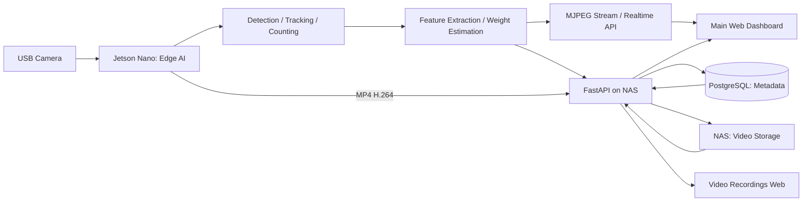

# VISION SWINE

## การพัฒนาโมเดล AI สำหรับการนับจำนวนและประเมินน้ำหนักสุกรในโรงเรือน

**Development of AI Models for Pig Counting and Weight Estimation in Swine Housing**

สถานะ: Prototype / Technical Handover · 26 พฤศจิกายน 2569

## 1. ภาพรวมโครงการ

VISION SWINE เป็นระบบต้นแบบสำหรับตรวจจับ ติดตาม นับจำนวน และประเมินน้ำหนักสุกรจากภาพกล้อง USB โดยประมวลผลบน NVIDIA Jetson Nano แสดงผลผ่าน Web Dashboard และส่งข้อมูลไปจัดเก็บบน NAS เพื่อเรียกดูย้อนหลัง

งานตรวจจับนำโมเดลพื้นฐานที่ได้รับจากบริษัทมาต่อยอดเป็นระบบ Tracking และ Counting ส่วนการพัฒนาโมเดลประเมินน้ำหนักเป็นงานแยกที่ใช้ข้อมูลภาพและน้ำหนักจริงจากชุดข้อมูลอ้างอิง โดยโมเดลที่นำไปใช้งานบนบอร์ดในชุดส่งมอบคือ Linear Regression แบบ Split

## 2. สถาปัตยกรรมระบบ



- Jetson Nano: ประมวลผล AI และให้บริการภาพสด/สถานะผ่านพอร์ต 8080
- NAS: รับข้อมูล Session, Weight, Counting และ Video ผ่าน FastAPI; จัดเก็บ Metadata ใน PostgreSQL และไฟล์ MP4 ในพื้นที่ Storage
- Main Dashboard: React + Vite บน Jetson Nano
- Video Recordings Web: React + Vite แยกบน NAS ผ่าน Nginx พอร์ต 8090 ตามการตั้งค่าต้นแบบ
- Remote Access: Tailscale ภายใต้สิทธิ์และนโยบายของบริษัท

## 3. โครงสร้างชุดส่งมอบ

```text
VISION_SWINE/
├── 01_Jetson_Nano/
│   ├── Source_Code/
│   └── Documentation/
├── 02_Estimation/
│   ├── Source_Code/
│   │   └── dataset-2/
│   └── Documentation/
├── 03_Backend_NAS/
│   ├── Source_Code/
│   └── Documentation/
├── 04_3D_Design/
│   ├── Exports/
│   ├── Documentation/
│   ├── Reference/
│   ├── Scripts/
│   └── README.md
├── .gitignore
└── README.md
```

## 4. คู่มือและองค์ประกอบของระบบ

| ส่วนงาน | Source / เอกสาร | ขอบเขต |
| --- | --- | --- |
| Jetson Nano | [Source Code](./01_Jetson_Nano/Source_Code/) · [Documentation](./01_Jetson_Nano/Documentation/) | ติดตั้งบอร์ด ระบบ AI กล้อง เครือข่าย Dashboard และแก้ไขปัญหา |
| Estimation | [Source Code](./02_Estimation/Source_Code/) · [Documentation](./02_Estimation/Documentation/) | การเตรียมข้อมูล ฝึก Segmentation สกัดคุณลักษณะ ฝึกและประเมินโมเดลน้ำหนัก |
| Backend NAS | [Source Code](./03_Backend_NAS/Source_Code/) · [Documentation](./03_Backend_NAS/Documentation/) | API, PostgreSQL, Storage, Video Recordings Web และสคริปต์ดูแลระบบ |
| 3D Design | [โฟลเดอร์งานออกแบบ](./04_3D_Design/) · [Documentation](./04_3D_Design/Documentation/) | CAD ชุดติดตั้งคานสี่เหลี่ยมและคานกลม ไฟล์แก้ไขและไฟล์แลกเปลี่ยน |

คู่มือฉบับเต็มใช้สำหรับรายละเอียดการติดตั้งและตรวจรับ ส่วน README นี้เป็นจุดเริ่มต้นสำหรับผู้รับมอบ

### 4.1 Jetson Nano

- `src/vision_swine/`: โปรแกรมหลัก Detection, Tracking, Counting, Feature Extraction, Weight Prediction, Streaming, Recording และ Upload
- `models/`: weights22k ในรูปแบบ PT, ONNX, TensorRT Engine และ Regression artifacts (โมเดล, scaler, portable JSON)
- `config/gate.json`: การตั้งค่าเส้นนับ
- `web/`: React/Vite source และไฟล์ build ที่จัดเตรียมไว้
- `System_Setup/`: systemd service, startup delay, OpenBLAS, USB Wi-Fi rule และ Nginx config
- `requirements_environment.txt`: รายการ Environment อ้างอิง ไม่ใช่การรับรองว่าติดตั้งทุกแพ็กเกจด้วยคำสั่งเดียวได้

Environment ต้นแบบที่ระบุในคู่มือ: L4T R32.7.1 / JetPack 4.6.1, ARM64, Python 3.8.0, CUDA 10.2, TensorRT 8.2.1.8, OpenCV 4.10.0 และ NumPy 1.23.5

### 4.2 Estimation

Dataset-1 เป็นชุดทดลองอิสระที่อธิบายไว้ในคู่มือเพื่อเก็บประวัติการพัฒนา ไม่ใช่ขั้นตอนต่อเนื่องของ Dataset-2 และไม่ใช่ชุดหลักของ Source Code ส่งมอบปัจจุบัน

Dataset-2 ประกอบด้วยสองสายงาน: การฝึก YOLO Segmentation จากภาพ RGB/Mask คู่ และการสร้างชุดข้อมูลสำหรับประเมินน้ำหนักจาก RGB_9579 ผ่าน Mask, QC, Skeleton, Feature Extraction และการจับคู่ Ground Truth Weight

คุณลักษณะ 8 ตัวแปร: Area, Perimeter, Bounding_Box_Length, Bounding_Box_Width, Deviation, Skeleton_Length, Straight_Distance และ Straightness

โมเดลที่ศึกษา: Linear Regression, Polynomial Regression, ANN และ Polynomial ANN โดยประเมินแบบ Random Split, GroupKFold และ Leave-One-Group-Out (LOGO)

ตามคู่มือมีภาพ RGB_9579 จำนวน 9,578 ภาพ ภาพ/Mask คู่ 3,073 คู่ และ Model Dataset 9,313 แถวจาก 73 Pig_ID ตัวเลขเหล่านี้เป็นหลักฐานจากการพัฒนาที่บันทึกไว้ ไม่ใช่ผลนับจาก ZIP ชุดส่งมอบล่าสุด

| วิธีประเมิน | โมเดลที่มี MAE ต่ำสุดในผลที่บันทึก | MAE (kg) | RMSE (kg) | R² |
| --- | --- | ---: | ---: | ---: |
| Random Split (Test) | Polynomial ANN | 4.175 | 5.836 | 0.9668 |
| GroupKFold | Polynomial Regression | 4.462 | 6.072 | 0.9643 |
| LOGO | Polynomial Regression | 4.463 | 6.069 | 0.9643 |

ผลดังกล่าวไม่ใช่ผลยืนยันความแม่นยำในโรงเรือนเป้าหมาย และ R² ไม่ใช่เปอร์เซ็นต์ความแม่นยำโดยตรง

Environment อ้างอิงของ Dataset-2: Python 3.13.14 และรายการแพ็กเกจใน `requirements_environment.txt` ควรตรวจ GPU/CUDA และ path ก่อนรันซ้ำ โดยเฉพาะ `data.yaml` และ `config.py` ซึ่งอาจอ้างตำแหน่งบนเครื่องเดิม

### 4.3 Backend NAS

- `management_system/backend/`: FastAPI, PostgreSQL connection และ Routers สำหรับ Sessions, Weights, Counting, Videos, Storage
- `management_system/frontend/video-recordings-web/`: เว็บดูวิดีโอย้อนหลังแยกจาก Dashboard หลัก
- `database/scripts/` และ `database/sql/`: สคริปต์ export schema และ `schema_v2_current.sql`
- `storage/images/`, `storage/videos/`, `logs/`: โครงสร้างพื้นที่ทำงาน ไม่รวมข้อมูลที่เกิดจากการใช้งานเดิม
- `tools/`: สคริปต์เริ่มบริการและ pgweb executable

| Endpoint | หน้าที่ |
| --- | --- |
| `/health`, `/health/database` | ตรวจสถานะ API และฐานข้อมูล |
| `/sessions` | จัดการรอบประมวลผล |
| `/weights` | ข้อมูลประเมินน้ำหนัก |
| `/counting-events` | เหตุการณ์นับ IN/OUT |
| `/videos`, `/videos/{video_id}/file` | รายการวิดีโอและเรียกเล่นไฟล์ |
| `/system/storage` | สถานะพื้นที่จัดเก็บ |

ตั้งค่า `.env` จาก `.env.example` โดยใช้ค่าจริงที่ผู้ดูแลระบบอนุญาต ไม่ส่งรหัสผ่านผ่าน GitHub ตรวจ `python-multipart` สำหรับการอัปโหลดไฟล์และตรวจสิทธิ์ execute/line endings ของ shell scripts ก่อนใช้งานบน Linux

### 4.4 3D Design

งานออกแบบ CAD สำหรับ Jetson Nano B01 และกล้อง ELP-USB4K02AF-KL100W ประกอบด้วยเคส V5S, Camera Mount V3, Mounting Plate V3, Adapter V1 และชุดประกอบคานสี่เหลี่ยม 50 × 50 มม. กับคานกลม Ø50 มม.

- `Exports/01_Fusion/`: ไฟล์แก้ไข CAD
- `Exports/02_STEP/`: ไฟล์แลกเปลี่ยน CAD
- `Exports/03_STL/`: ไฟล์ชิ้นส่วนต้นแบบ
- `Documentation/`: รายงานผลตรวจ CAD และประวัติการพัฒนา
- `Scripts/`: Python scripts สำหรับ Fusion API
- `Reference/`: ไฟล์อ้างอิงอุปกรณ์ (ตรวจสิทธิ์ก่อนส่งต่อ)

แบบยังไม่อนุมัติให้ผลิตหรือติดตั้งจริง ไม่ผ่านการทดสอบความแข็งแรงและต้องให้วิศวกรตรวจสอบทางรับแรง ฮาร์ดแวร์ และระบบป้องกันการตกหล่นก่อนใช้งานเหนือโรงเรือน

## 5. ดาวน์โหลดและคืนโครงสร้าง Dataset-2

ไฟล์ ZIP จำนวน 17 ไฟล์จัดเตรียมไว้สำหรับ GitHub Releases แบ่งเป็น Dataset ต้นทาง 11 ไฟล์ และภาพผลลัพธ์การประมวลผล 6 ไฟล์ (ยังไม่อัปโหลด ณ วันที่จัดทำ README) ส่วนไฟล์ขนาดเล็กและ Source Code อยู่ในชุด Repository ตามกฎ `.gitignore`

หลังอัปโหลดแล้ว ให้เปิดแท็บ Releases ของ Repository นี้และเลือกชุดส่งมอบที่ตรงกับเวอร์ชันของ Source Code

ตำแหน่งทั้งหมดในตารางสัมพันธ์กับ `02_Estimation/Source_Code/dataset-2/dataset/`

| ไฟล์ Release | ตำแหน่งแตกไฟล์ (relative) | ขนาด MiB ที่ตรวจไว้ |
| --- | --- | ---: |
| `fold1.zip` | `PigRGB-Weight/RGB_9579/` | 1442.39 |
| `fold2.zip` | `PigRGB-Weight/RGB_9579/` | 1518.72 |
| `fold3.zip` | `PigRGB-Weight/RGB_9579/` | 1427.93 |
| `fold4.zip` | `PigRGB-Weight/RGB_9579/` | 1315.02 |
| `fold5.zip` | `PigRGB-Weight/RGB_9579/` | 1376.46 |
| `RGB_3394_Below_100kg.zip` | `PigRGB-Weight/RGB_MASK_3394/RGB_3394/` | 1601.58 |
| `RGB_3394_From_100kg.zip` | `PigRGB-Weight/RGB_MASK_3394/RGB_3394/` | 810.72 |
| `train.zip` | `PigRGB-Weight/transfer_learning_dataset/images/` | 1685.56 |
| `val.zip` | `PigRGB-Weight/transfer_learning_dataset/images/` | 366.69 |
| `test.zip` | `PigRGB-Weight/transfer_learning_dataset/images/` | 359.89 |
| `segmentation_training.zip` | `.` (รากของ dataset) | 1071.50 |

### Output Archives — GitHub Releases

ไฟล์ภาพผลลัพธ์จากการประมวลผล Dataset-2 จำนวน 6 ZIP

ตำแหน่งทั้งหมดในตารางนี้สัมพันธ์กับ
`02_Estimation/Source_Code/dataset-2/output/`

| ไฟล์ Release | ตำแหน่งแตกไฟล์ (relative) |
| --- | --- |
| `masks.zip` | `segmentation/` |
| `refined_masks.zip` | `segmentation/` |
| `segmentation_review.zip` | `segmentation/` |
| `target_mask.zip` | `segmentation/` |
| `main_path_skeleton.zip` | `feature_extraction/` |
| `raw_skeleton.zip` | `feature_extraction/` |

ให้แตกไฟล์โดยรักษาชื่อและโครงสร้างโฟลเดอร์เดิม
และตรวจสอบว่าไม่มีโฟลเดอร์ซ้อนกันโดยไม่จำเป็น

**สรุปไฟล์ GitHub Releases**

- Dataset ต้นทาง: 11 ZIP
- Segmentation Output: 4 ZIP
- Feature Extraction Output: 2 ZIP
- รวมทั้งหมด: 17 ZIP

### โครงสร้างหลังแตกไฟล์

```text
 dataset-2/
 ├── dataset/
 │   ├── PigRGB-Weight/
 │   │   ├── RGB_9579/
 │   │   │   ├── fold1/ ... fold5/
 │   │   ├── RGB_MASK_3394/
 │   │   │   ├── MASK_3394/
 │   │   │   └── RGB_3394/  # รวมโฟลเดอร์ทั้งสองช่วงน้ำหนัก
 │   │   └── transfer_learning_dataset/
 │   │       ├── images/  # train/, val/, test/
 │   │       ├── labels/
 │   │       ├── raw_labels/
 │   │       ├── segmentation_visualization/
 │   │       └── data.yaml
 │   ├── segmentation_training/
 │   ├── ภาพผิดหนัก/
 │   └── Weight_Ground_Truth.xlsx
 ├── model/
 ├── output/
 │   ├── segmentation/
 │   │   ├── masks/
 │   │   ├── refined_masks/
 │   │   ├── segmentation_review/
 │   │   ├── target_mask/
 │   │   └── segmentation_usable_dataset.xlsx
 │   ├── feature_extraction/
 │   │   ├── main_path_skeleton/
 │   │   ├── raw_skeleton/
 │   │   ├── feature_dataset.xlsx
 │   │   └── model_dataset.xlsx
 │   └── estimation_model/
 ├── runs/
 ├── source/
 ├── README.md
 └── requirements_environment.txt
```

1. Clone Repository และดาวน์โหลด ZIP ทั้ง 17 ไฟล์จาก Release ที่ตรงกัน
2. สร้างโฟลเดอร์ปลายทางตามตารางหากยังไม่มี เพราะ Git ไม่ติดตามโฟลเดอร์ว่าง
3. เปิดดูรายการภายใน ZIP ก่อนแตก หาก ZIP มีโฟลเดอร์ชื่อเดียวกับปลายทางอยู่แล้ว ให้แตกที่โฟลเดอร์แม่ที่เหมาะสม หากไม่มี ให้แตกลงในโฟลเดอร์ชื่อดังกล่าวโดยตรง ป้องกันโฟลเดอร์ซ้อนชื่อซ้ำ
4. รวมโฟลเดอร์กลุ่มสุกรจาก Below_100kg และ From_100kg ไว้ใต้ `RGB_3394/` เดียวกัน โดยไม่เปลี่ยนชื่อกลุ่มหรือภาพ การแบ่ง ZIP เป็นเพียงการจัดเก็บ ไม่ใช่การแบ่งชุดฝึกใหม่
5. แตก ZIP ขนาดเล็กที่อยู่ใน Repository ด้วย เช่น `MASK_3394.zip`, `labels.zip`, `raw_labels.zip`, `segmentation_visualization.zip` ให้ได้โครงสร้างดังภาพ
6. ตรวจจำนวนไฟล์ ชื่อภาพและ Mask คู่กัน รวมถึง Train/Val/Test และ Ground Truth ก่อนรันสคริปต์ ตรวจสอบ ZIP และค่า SHA-256 หากมีรายการ checksum จาก Release

> โครงสร้างภายใน ZIP ชุดใหม่ยังต้องทดสอบจริงก่อนเผยแพร่ ห้ามลบต้นฉบับจนกว่าจะยืนยันว่าข้อมูลครบและแตกไฟล์ได้

## 6. แนวทางติดตั้งและตรวจรับ

- Jetson Nano: Flash → USB Wi-Fi → Tailscale → Upload Code/Models → Python/Libraries → Service/Dashboard → Test ตามคู่มือ Jetson Nano; สร้าง Environment บนบอร์ดใหม่และติดตั้ง/build Frontend บนบอร์ดตามคู่มือ
- NAS: เตรียม PostgreSQL และ schema → สร้าง Environment ของ Backend → ตั้งค่า `.env` → เริ่ม API → ตั้งค่า Nginx/Video Web → ตรวจ Health/Database/Storage และทดสอบการรับส่งข้อมูลกับ Jetson
- Estimation: สร้าง Python Environment บนเครื่องพัฒนา คืนโครงสร้าง Dataset และตรวจ path ก่อนดำเนินการตามสคริปต์ในคู่มือ (ไม่จำเป็นต้องฝึกใหม่เพื่อเปิดระบบต้นแบบบน Jetson)
- CAD: เปิด Full Assembly ใน Fusion ตามชนิดคาน ตรวจไฟล์ Export และอ้างอิงรายงานก่อนแก้ไขแบบ

## 7. สถานะการทดสอบและข้อจำกัด

- คู่มือ Jetson บันทึกผลตรวจ API ต่อเนื่อง 60/60 ครั้งในช่วงประมาณ 60 นาที การ reconnect กล้อง และการแสดงภาพสด แต่ยังต้องทวนสอบการติดตั้งใหม่ครบวงจร
- เคยส่งข้อมูลน้ำหนักและวิดีโอไป NAS ได้ รวมถึงการอ่านวิดีโอแบบ HTTP Range (206) แต่ Weight POST เคย Timeout จึงยังไม่รับประกันว่าข้อมูลครบทุกเหตุการณ์
- คู่มือ Backend บันทึกผล Health/Database/Storage HTTP 200 และการเปิด Video Recordings Web ได้ แต่ยังต้องตรวจ End-to-End, Restore, Autostart หลัง Container Restart และการยืนยันตัวตน/สิทธิ์การเข้าถึง
- โมเดลน้ำหนักเป็น Proof of Concept จาก Dataset งานวิจัย ไม่ใช่การรับรองความแม่นยำในฟาร์มเป้าหมาย ความสูงกล้อง มุมมองและสเกลภาพมีผลต่อ Feature โดยเฉพาะ Area ควรเก็บภาพพร้อมน้ำหนักจริงจากโรงเรือนและประเมินใหม่
- CAD เป็นต้นแบบเพื่อพัฒนาต่อ ไม่ใช่แบบรับรองความปลอดภัยหรืออนุมัติผลิต

## 8. ความปลอดภัยและการจัดการไฟล์

- ใช้ Repository แบบ Private ภายใต้บัญชีหรือองค์กรที่บริษัทอนุญาต
- ห้าม commit รหัสผ่านจริง, `.env`, SSH keys, Tailscale Auth Key, ข้อมูล SFTP, Logs หรือข้อมูลจริงจากฐานข้อมูลโดยไม่ได้รับอนุญาต
- ตรวจ Source Code, config, shell scripts, web/dist, เอกสาร Word/PDF, ZIP และไฟล์ CAD/รายงานก่อนเผยแพร่ ไม่ถือว่า `.gitignore` เป็นการตรวจความปลอดภัยทั้งหมด
- คู่มือที่มีข้อมูลบัญชีจริงให้เก็บต้นฉบับไว้และส่งมอบแยกผ่านช่องทางที่ได้รับอนุญาต ไม่รวมใน Repository; หากต้องการเผยแพร่คู่มือผ่าน Repository ให้ใช้ฉบับที่นำข้อมูลลับออกแล้ว
- ไม่รวม `.venv`, `venv`, `node_modules`, cache, PostgreSQL data directory, database dumps และไฟล์วิดีโอ runtime ใน Git ปกติ เก็บข้อมูลสำรองที่จำเป็นผ่านช่องทางควบคุมสิทธิ์ของบริษัท
- ตรวจสิทธิ์การเผยแพร่โมเดลที่บริษัทให้มา, PigRGB-Weight และไฟล์ CAD อ้างอิง NVIDIA ก่อนอัปโหลด แม้ Repository จะเป็น Private

## 9. แนวทางพัฒนาต่อยอด

เก็บข้อมูลและปรับเทียบกล้องในโรงเรือนจริง พัฒนาและประเมินโมเดลสำหรับสุกรที่ไม่เคยปรากฏในชุดฝึก เพิ่มความทนทานของ Tracking/Counting ปรับปรุงการส่งข้อมูลซ้ำอย่างปลอดภัยและการกู้คืนระบบ รวมถึงตรวจสอบความแข็งแรงและความเหมาะสมของชุดติดตั้งก่อนใช้งานจริง

---

**VISION SWINE — Technical Handover / Prototype**

เอกสารอ้างอิงภายในโครงการ: Jetson Nano Technical Manual (22 หน้า), Estimation Technical Manual (24 หน้า), Backend NAS Technical Manual v0.8.7 (47 หน้า), 3D Handover (11 หน้า)
